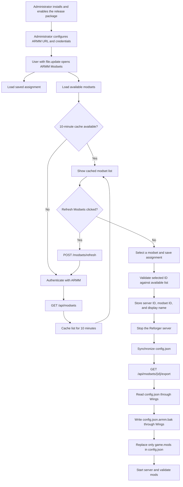

# ARMM Modset Manager for Pterodactyl 2.x

Native **ARMM Modsets** tab for Arma Reforger servers in Pterodactyl 2.x.

**Version:** declared in [`extension.json`](extension.json) · **Verified by operator:** Pterodactyl `v2.0.0-beta.2` (UI, modset listing, and config sync).

## Features

- Configure ARMM server URL and credentials centrally in **Admin → Extensions**.
- Fetch accessible modsets from `GET /api/modsets` and select one per server.
- Store per-server assignments in `ext_armm_modsets_assignments`.
- **Synchronize config.json** reads the selected modset's `/api/modsets/{id}/export`, backs up `config.json` as `config.json.armm.bak`, and replaces only `game.mods` through Wings.
- Preserve mod version fields returned by ARMM when the corresponding setting is enabled.

**Not supported:** automatic synchronization on every server start. This extension synchronizes only when the button is clicked, and sync should be performed with the game server stopped.

## Quick start

1. Download `armm-modsets-v<release-version>.zip` from the [GitHub Releases page](https://github.com/morok101st/Arma-Reforger-Mod-Manager-Pterotactyl-Extension/releases).
2. Sign in to Pterodactyl as an administrator and open **Admin → Extensions**.
3. Use the Extensions UI to upload, install, and enable the downloaded release package.
4. Open **ARMM Modset Manager** in the Extensions list and configure the ARMM URL and credentials.
5. Open an Arma Reforger server, select **ARMM Modsets**, assign a modset, and synchronize `config.json` while the game server is stopped.

Use the release asset, not GitHub's automatically generated **Source code** ZIP. The latter is a repository snapshot and is not an installable extension package. Detailed instructions are in [Install / Update](docs/INSTALL.md).

## User workflow



The modset list loads automatically when the tab opens. **Refresh Modsets** bypasses the cache and fetches the current list from ARMM. `config.json` synchronization is always manual and should be performed with the game server stopped.

## Requirements

### Panel operators

- Pterodactyl `v2.0.0-beta.2` (target version) and a Panel version compatible with the extension manifest
- Administrator access to the Pterodactyl Panel
- A working Panel ↔ Wings connection
- A reachable ARMM HTTPS endpoint and an ARMM account with access to the required modsets

### Building from source only

Building is optional for normal installations. It requires a Linux host with Docker, Git, Python 3, `zip`, shell access, sufficient disk space, and internet access for Docker images, npm, and GitHub. See [Build](docs/BUILD.md).

## Repository structure

```text
extension.json        Extension manifest
src/                  PHP backend and React tab
routes/               Extension API routes
database/migrations/   Assignment table
scripts/build.sh       Isolated Docker-based build
docs/BUILD.md          Maintainer build instructions
docs/INSTALL.md        UI installation, update, verification, and rollback
docs/CONFIGURATION.md  ARMM settings and usage
docs/TESTING.md        Panel integration-test instructions
tests/                 Pterodactyl Pest integration tests
scripts/test.sh        Test runner for a prepared Panel checkout
.github/workflows/     Build artifact and release publishing workflow
```

## Security notes

Download packages only from the official GitHub Releases page. Never commit `.env`, login cookies, API passwords, Laravel `APP_KEY`, Wings tokens, real server `config.json`, or database dumps. Extension configuration resides within the Panel, not in this repository. The server receives only the mod list via the file API. `tls_verify=1` is recommended.

## Support scope

This is a dedicated integration for the currently tested Pterodactyl beta. New Panel betas may change SDK or file contracts and require a rebuild and code adaptation. PHP syntax checks and TypeScript compilation are not substitutes for integration tests.
